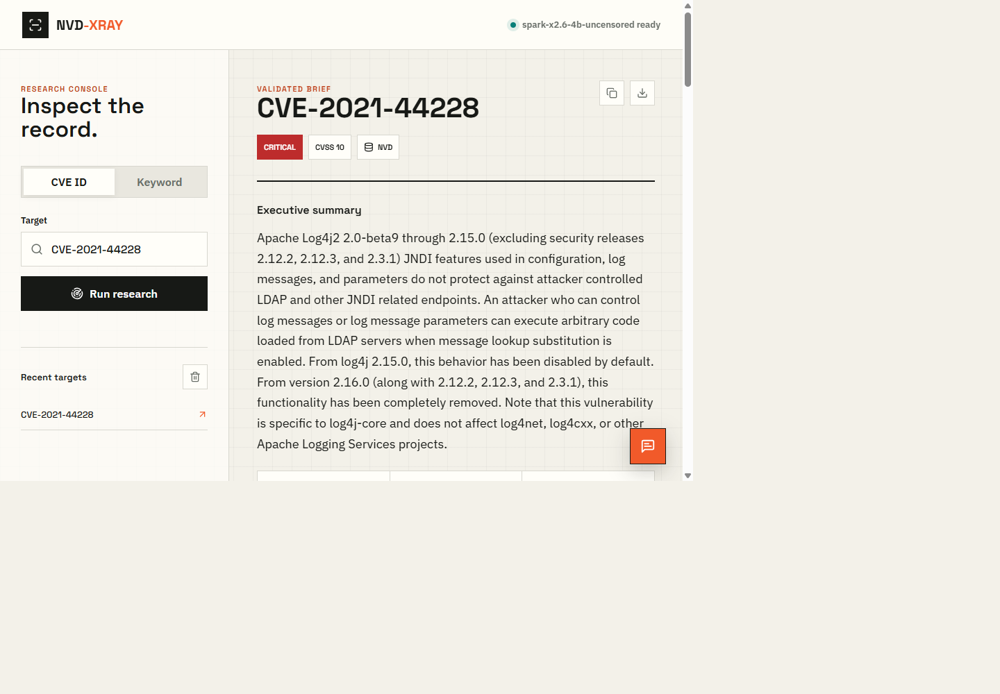

# NVD-XRAY

NVD-XRAY is a production-oriented vulnerability research console for NVD CVE API 2.0. It provides a responsive Flask web interface, concise reports, and a report-grounded chatbot backed by LM Studio's OpenAI-compatible local endpoint and Pydantic validation.



## Capabilities

- Research an exact CVE identifier or search NVD by product and vulnerability keyword.
- Display severity, CVSS, affected products, remediation, security guidance, limitations, and references.
- Keep NVD evidence separate from model-generated defensive guidance.
- Preserve unknown values instead of fabricating scores, versions, or patches.
- Match exact CVE records with public PoC metadata from PoCIndex.
- Show a bounded set of PoC repository/reference links without downloading or executing code.
- Ask follow-up questions in a report-grounded web chatbot without exposing or accepting untrusted report context.
- Export validated reports as JSON from the web console.
- Retry bounded NVD timeout, rate-limit, and transient server failures.

## Setup

```powershell
python -m venv .venv
.venv\Scripts\Activate.ps1
pip install -r requirements.txt
Copy-Item .env.example .env
```

Start LM Studio and load the requested local model:

```powershell
lms server start
lms load "spark-x2.6-4b-uncensored" --identifier "spark-x2.6-4b-uncensored" -y
```

Set the matching `LLM_*` values in `.env`. An `NVD_API_KEY` is optional but recommended for higher NVD request limits. Never commit `.env`.

## Web Console

Run the development server:

```powershell
python app.py
```

Run with the production WSGI server:

```powershell
waitress-serve --host=127.0.0.1 --port=5000 app:app
```

Open `http://127.0.0.1:5000`. Liveness is available at `http://127.0.0.1:5000/health`; model readiness is available at `http://127.0.0.1:5000/ready`. The readiness route returns `503` when LM Studio or the configured model is unavailable.

After a report is generated, the assistant button opens a report-grounded chatbot. The browser receives a short-lived `report_id`; the server resolves the validated report from its own bounded cache and never accepts report JSON from the browser.

## API Endpoints

- `POST /api/research`: accepts `{"query": "CVE-2021-44228"}` and returns a validated report plus `report_id`.
- `POST /api/chat`: accepts `report_id` and `question`, then answers only from the cached report context.
- `GET /health`: process liveness.
- `GET /ready`: verifies LM Studio is reachable and the configured model is available.

## Command Line

```powershell
python main.py --cve-id CVE-2021-44228
python main.py --query "Apache Log4j remote code execution"
python main.py --cve-id CVE-2021-44228 --json
python main.py --cve-id CVE-2021-44228 --trace
```

The default CLI format is a readable terminal report. Use `--json` for automation and `--trace` for tool-call debugging.

## Environment

```text
LLM_API_KEY=lm-studio
LLM_BASE_URL=http://127.0.0.1:1234/v1
LLM_MODEL=spark-x2.6-4b-uncensored
LLM_TIMEOUT_SECONDS=120
NVD_API_KEY=
NVD_TIMEOUT_SECONDS=20
NVD_MODEL_PRODUCT_LIMIT=20
NVD_MODEL_REFERENCE_LIMIT=12
POCINDEX_TIMEOUT_SECONDS=15
POCINDEX_RESULT_LIMIT=6
FLASK_HOST=127.0.0.1
FLASK_PORT=5000
FLASK_DEBUG=false
```

PoC links are displayed as external metadata from PoCIndex. NVD-XRAY does not download, validate, or execute PoC code and does not claim that any linked repository is safe.

For internet-facing deployment, place the WSGI server behind TLS, authentication, request-rate controls, a durable shared report store, and a secrets manager. Keep LM Studio bound to localhost unless an authenticated private network exposes it intentionally.

## Tests

```powershell
python -m unittest discover -s tests -v
```

## Runtime Requirements

- Python 3.11 or newer
- LM Studio local server with `spark-x2.6-4b-uncensored` loaded and tool use enabled
- Outbound HTTPS access to NVD and PoCIndex
